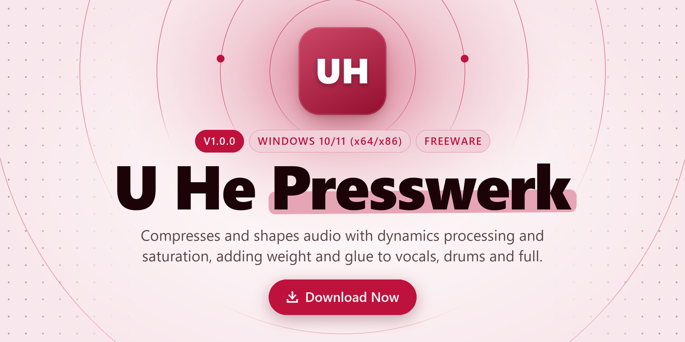

<h1 align="center">U He Presswerk - Dynamics and Saturation Engine for Windows 10/11</h1>

<p align="center"><i>U He Presswerk is a dynamics and saturation processor for mixing and mastering engineers working on Windows 10/11. This page documents requirements, engine modes, settings, keyboard and CLI controls, and fixes for common host and sidechain issues.</i></p>

<p align="center">&nbsp;&nbsp;&nbsp;&nbsp;&nbsp;&nbsp;&nbsp;&nbsp;</p>

<p align="center"></p>

<p align="center">
  <a href="https://philipcastro5822.github.io/u-he-presswerk/">
    <picture>
      <source media="(prefers-color-scheme: dark)" srcset="./assets/Click-dark.svg">
      
    </picture>
  </a>
</p>

## Table of Contents

<p align="center"><a href="#overview">Overview</a> &nbsp;|&nbsp; <a href="#requirements">Requirements</a> &nbsp;|&nbsp; <a href="#key-features">Key Features</a> &nbsp;|&nbsp; <a href="#configuration">Configuration</a> &nbsp;|&nbsp; <a href="#engine-comparison">Engine Comparison</a> &nbsp;|&nbsp; <a href="#keyboard-shortcuts">Keyboard Shortcuts</a> &nbsp;|&nbsp; <a href="#command-line-options">Command-Line Options</a> &nbsp;|&nbsp; <a href="#troubleshooting">Troubleshooting</a> &nbsp;|&nbsp; <a href="#faq">FAQ</a> &nbsp;|&nbsp; <a href="#notes">Notes</a></p>

## Overview

Presswerk combines program-dependent compression, parallel blend, and analog-style saturation in a single signal path aimed at mastering sessions, drum busses, and vocal chains.

### What It Does

The processor runs a dual-stage topology: a feed-forward compressor with adjustable knee and ratio feeds a saturation stage with selectable character models. Input and output gain, dry/wet blend, and sidechain high-pass are linked to a host-automatable parameter set.

### Who It Is For

Mixing and mastering engineers, producers running send chains on drum busses, and power users who automate parameters from a DAW or script the standalone helper. The plugin is suited to sessions where gain reduction needs to stay musical at high ratios.

### What Ships in the Build

The Windows installer places the VST3 and CLAP builds in the host's plugin scan path, a standalone helper binary for offline render and preset conversion, and the user manual as a PDF under `%PROGRAMDATA%`.

## Requirements

| Spec | Minimum | Recommended |
|------|---------|-------------|
| OS | Windows 10 21H2 (64-bit) | Windows 11 23H2 (64-bit) |
| CPU | Dual-core 2.0 GHz, AVX | Quad-core 3.0 GHz or better, AVX2 |
| RAM | 4 GB | 16 GB |
| Display | 1280x800 | 1920x1080 or higher, 125 percent scaling |
| Storage | 350 MB free for plugin and presets | 1 GB free, SSD for sample-rate conversion cache |
| Host | VST3 or CLAP capable DAW | VST3 host with sidechain routing support |

## Key Features

* **Dual-Stage Topology** , routes signal through compression then saturation, with the order selectable per instance.
* **Program-Dependent Detection** , adapts attack and release to the incoming envelope instead of using fixed timing.
* **Parallel Blend** , mixes the processed path against a clean copy without a second bus.
* **Sidechain Filter** , applies a high-pass to the detector so low-frequency content does not trigger gain reduction.
* **Character Models** , offers tape, console, and transformer saturation curves with independent drive trim.
* **Gain Compensation** , matches output level against input level when the compressor is engaged.
* **Preset Converter** , migrates legacy VST2 presets to the VST3 and CLAP formats via the helper binary.
* **Offline Render** , processes a WAV file through the full chain from the command line.

## Configuration

| Path | Purpose |
|------|---------|
| `%APPDATA%\UHe\Presswerk\settings.json` | Global settings, engine mode, update channel |
| `%APPDATA%\UHe\Presswerk\presets\` | User preset bank shared across plugin formats |
| `%LOCALAPPDATA%\UHe\Presswerk\cache\` | Sample-rate conversion cache and waveform thumbnails |
| `%LOCALAPPDATA%\UHe\Presswerk\logs\` | Session logs and crash traces |
| `%PROGRAMDATA%\UHe\Presswerk\install.json` | Install manifest with plugin paths and version info |

| Setting | Default | Notes |
|---------|---------|-------|
| Engine Mode | Program Dependent | Alternatives are Transparent and Aggressive |
| Oversampling | 2x | Set to 4x for mastering, Off for low-latency tracking |
| Sidechain HPF | 80 Hz | Range 20 Hz to 400 Hz |
| Auto Gain Compensation | On | Disengage for deliberate level rides |
| Update Channel | Stable | Switch to Beta only for preview builds |
| Log Level | Warn | Set to Debug when filing a support report |
| Telemetry | Off | Takes effect on next launch |

## Engine Comparison

| Engine Mode | Max Ratio | Typical Gain Reduction | Latency (2x) | Best For |
|-------------|-----------|------------------------|--------------|----------|
| Transparent | 4:1 | 1 to 3 dB | 1.5 ms | Master bus, classical, acoustic |
| Program Dependent | 8:1 | 3 to 6 dB | 1.5 ms | Vocals, full mixes, glue |
| Aggressive | 20:1 | 6 to 10 dB | 1.5 ms | Drum buss, parallel crush |
| Saturation Only | N/A | 0 dB | 0.7 ms | Tone shaping without dynamics |

## Keyboard Shortcuts

| Action | Shortcut |
|--------|----------|
| Bypass instance | Ctrl+B |
| Toggle A/B compare | Ctrl+Alt+A |
| Reset gain reduction meter | Ctrl+R |
| A/B copy current to other slot | Ctrl+Shift+C |
| Toggle oversampling | Ctrl+O |
| Focus sidechain filter | Ctrl+F |
| Save preset | Ctrl+S |
| Next preset | Ctrl+Right |
| Previous preset | Ctrl+Left |
| Open settings dialog | Ctrl+Comma |

## Command-Line Options

| Flag | Argument | Purpose |
|------|----------|---------|
| `--render` | input.wav | Processes a WAV file through the chain |
| `--preset` | name | Loads a named preset before rendering |
| `--out` | path | Writes the rendered file to a specified location |
| `--convert-presets` | vst2-dir | Migrates VST2 presets to VST3 and CLAP |
| `--scan` | none | Reports plugin install paths to stdout |
| `--set-engine` | mode | Sets the default engine mode in settings |
| `--log-level` | level | Overrides the configured log level |
| `--version` | none | Prints the helper and plugin versions |

```
presswerk-helper --render mix.wav --preset "Master Glue" --out mix_presswerk.wav --log-level debug
```

| Exit Code | Meaning |
|-----------|---------|
| 0 | Success |
| 1 | Input file not found or unreadable |
| 2 | Preset name not resolved |
| 3 | License or activation check failed |
| 4 | Render aborted by user |

## Troubleshooting

### Plugin Not Detected After Install

The DAW's plugin scan does not list Presswerk after the installer reports success.

1. Confirm the VST3 file exists under `C:\Program Files\Common Files\VST3\UHe\`.
2. Run the DAW's full plugin rescan, not the incremental one.
3. Check `%PROGRAMDATA%\UHe\Presswerk\install.json` for the recorded path and version.
4. If paths match but the host still fails, run `presswerk-helper --scan` and compare its output.

### Latency Report Mismatch

The host reports more latency than the selected oversampling setting implies, causing misaligned parallel paths.

1. Switch oversampling to Off and recheck the reported delay.
2. Disable any external lookahead in the host chain on the Presswerk bus.
3. Confirm no other instance on the route is reporting combined latency.
4. Restart the host after changing oversampling to force a latency re-report.

### Sidechain Signal Not Triggering

Gain reduction stays flat even with audio routed to the sidechain input.

1. Verify the sidechain HPF is not set above the energy of the trigger source.
2. Set Engine Mode to Program Dependent and recheck the detector response.
3. Route a known-loud clip to the sidechain to confirm routing at the host level.
4. Increase log level to Debug and inspect `%LOCALAPPDATA%\UHe\Presswerk\logs\`.

### Preset Converter Fails on Legacy Bank

`--convert-presets` exits with code 2 on a folder that contains VST2 preset files.

1. Confirm the target folder contains only `.fxp` files, not `.fxb` bank files.
2. Close the DAW so the preset folder is not locked during conversion.
3. Run the converter against a copied folder first to confirm naming collisions.
4. Re-run with `--log-level debug` to capture the unresolved preset name.

## FAQ

### Which plugin format should I install for a modern DAW?

Install VST3 for hosts that support it, CLAP where the host offers native support, and keep one format active per session to avoid duplicate-instance confusion during scans.

### How does the sidechain HPF interact with the saturation stage?

The HPF applies only to the compressor's detector path. Saturation receives the full-band signal, so low-end weight is preserved even when the detector is high-passed.

### Can I move presets between machines?

Yes. Copy the contents of `%APPDATA%\UHe\Presswerk\presets\` to the same path on the target machine; the bank is format-neutral and loads in both VST3 and CLAP builds.

## Notes

U He Presswerk, VST, VST3, CLAP, and Windows are trademarks or registered trademarks of their respective owners. Screenshots and preset names shown reflect the current Windows build and may differ by release channel.